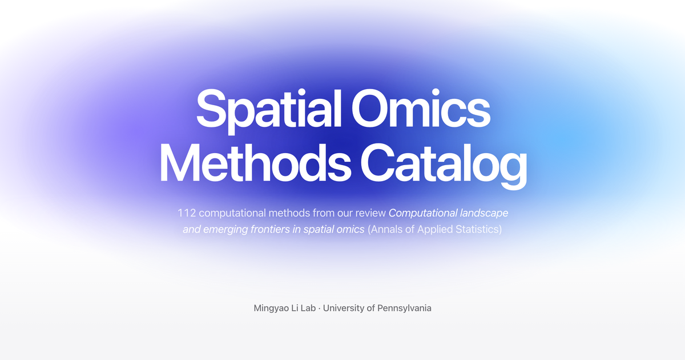

<p align="center">
  <a href="https://liranmao.github.io/spatial-omics-methods-catalog/">
    
  </a>
</p>

<h1 align="center">Spatial Omics Methods Catalog</h1>

<p align="center">
  <b>A curated, searchable guide to computational methods for spatial omics.</b><br>
  <a href="https://liranmao.github.io/spatial-omics-methods-catalog/"><b>Visit the website →</b></a>
</p>

---

## What is this?

Spatial omics has produced a fast-growing number of analysis methods, and picking the right one for your data is not easy.
The **Spatial Omics Methods Catalog** collects the 112 methods discussed in our review,
*Computational landscape and emerging frontiers in spatial omics* (Annals of Applied Statistics), into one website
where you can browse, compare and find them.

## What you can do on the website

- **See the big picture.** Methods are placed along the spatial omics analysis workflow, from spatially variable genes
  and cell-type deconvolution to alignment, integration, foundation models and more. Each task comes with a short
  animated explanation.
- **Follow the field over time.** A timeline shows every method by year and task, coloured by whether it is a
  statistical, deep learning or hybrid approach.
- **Find a method for your data.** Filter by task, modelling paradigm, programming language and model family, or simply
  search by name. Each entry shows the input data it needs and links to the paper (and code, where available).

## Contributing

This is a community resource, and we would love your help keeping it accurate and up to date.

- **Suggest a method.** Know a published spatial omics method with available code that should be here?
  [Open an issue](https://github.com/liranmao/spatial-omics-methods-catalog/issues/new) with the method name, its task,
  the input data it needs, its language, its core model and the paper DOI.
- **Report a correction.** Spotted a wrong year, missing code link or mislabelled input?
  [Let us know in an issue](https://github.com/liranmao/spatial-omics-methods-catalog/issues/new).
- **Edit directly.** All entries live in a single spreadsheet, [`methods.csv`](methods.csv). Pull requests that add or
  fix rows are very welcome.

## Citation

If you find the catalog useful, please cite our review:

> Mao L\*, Li C\*, Jiang S, Li W, Jin K, Zhang NR, Li M†. Computational landscape and emerging frontiers in spatial omics.
> *Annals of Applied Statistics*, in revision.
>
> \*Equal contribution · †Corresponding author

## Disclaimer

This catalog is not exhaustive. It lists the methods discussed in our review, and many other valuable methods are not
included. Inclusion is not an endorsement, and omission does not reflect on a method's quality. Entries summarize each
method as described in its own publication; some fields are derived automatically and may contain errors, so please
check the original paper before relying on them.

## About

The catalog is created and maintained by the
[Mingyao Li Lab](https://www.med.upenn.edu/apps/faculty/index.php/g275/p8122973), part of the Statistical Center for
Single-Cell and Spatial Genomics at the University of Pennsylvania.

<details>
<summary><b>For maintainers: how the site is built</b></summary>

<br>

The website is a static page served by GitHub Pages from the `docs/` folder.

1. Edit [`methods.csv`](methods.csv) (one row per method; Excel or Numbers is fine, keep it as UTF-8 CSV).
2. Rebuild the site data:
   ```bash
   python3 scripts/build_site.py
   ```
   This regenerates `docs/data/` (filter tags are derived automatically) and refreshes the cache stamp on the page.
3. Preview locally (optional):
   ```bash
   python3 -m http.server 8765 --directory docs
   ```
   then open http://127.0.0.1:8765.
4. Commit and push. The live site updates within a minute or two.

[`CHANGES.md`](CHANGES.md) records how the catalog differs from the table in the manuscript.

</details>

---

<p align="center">© Copyright Mingyao Li Lab, 2026.</p>
